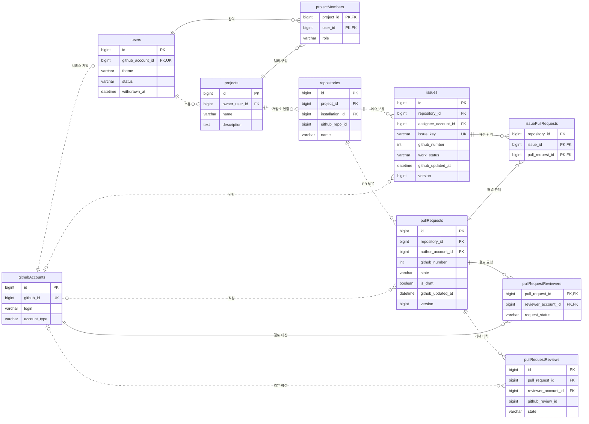
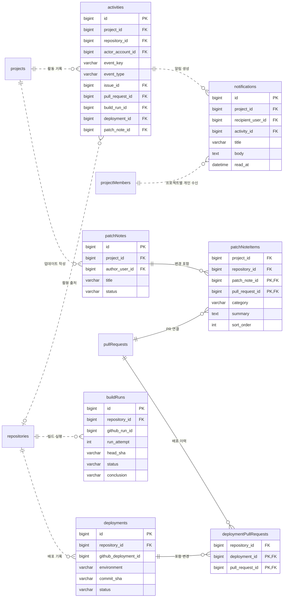
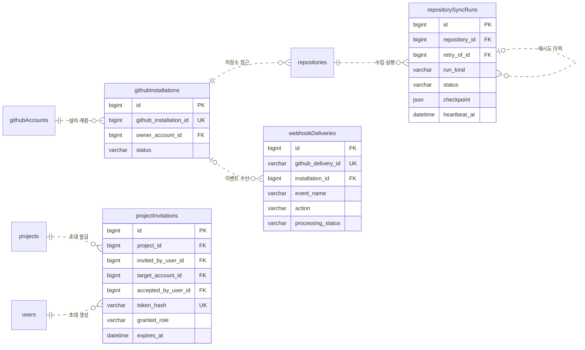

# zello ERD 초안

기준일: 2026-10-30. 현재 React 화면과 데이터 타입, `client/docs/feature.md`를 기준으로 작성한 **구현 전 설계안**이다. DB 마이그레이션이나 JPA 엔티티는 아직 생성하지 않았다.

dbdiagram에서 그릴 때는 [erd.sql](erd.sql) 전체를 **Import → MySQL**에서 가져온다. 기본 편집창에 직접 붙여넣으려면 [erd.dbml](erd.dbml)을 사용한다. SQL에는 21개 테이블의 PK·FK·고유 제약·CHECK·인덱스를 포함했고, [공식 CLI](https://dbml.dbdiagram.io/cli/)의 MySQL → DBML 변환으로 호환성을 확인했다. SQL은 DDL 원본이고 DBML은 그림 편집용 파생 파일이다.

**zello는 협업툴의 이름이다. `projects`는 zello 안에서 사용자가 관리하는 개별 프로젝트다.** 샘플에 등장하는 컬렉션·링크 공유는 예시 작업 내용이므로 `collections`, `links` 테이블을 만들지 않는다.

## 1. 범위와 가정

- 현재 화면: 개인 알림함, 내 작업, 대시보드, 이슈, PR, 변경 이력, 패치노트, 빌드·배포, 프로젝트 설정.
- 기획에 포함됐지만 서버 미구현: GitHub 로그인, 프로젝트 생성·초대·권한, 실제 GitHub 연동·동기화.
- 회원 한 명은 여러 프로젝트에 참여하고, 프로젝트 하나에 여러 저장소를 연결한다.
- **설계 가정:** 동일 GitHub 저장소를 여러 프로젝트에서 사용할 수 있다. `repositories`는 프로젝트별 연결 및 조회용 복제본이다. 원본 GitHub ID는 여러 프로젝트에 나타날 수 있지만 동일 프로젝트 안에서는 중복 연결하지 않는다.
- 현재와 같이 이슈 담당자는 한 명 또는 미지정이다. 이슈와 PR은 다대다이며, 첫 버전에서는 같은 저장소 연결 안에서만 연결한다.
- 현재 회의 UI는 등록 경로·날짜·맥락을 이슈에 기록한다. 별도의 회의 목록, 참석자, 회의록은 아직 없으므로 `meetings`는 확장 시 분리한다.
- 핵심 및 연동 16개, 화면에 있는 후속 기능인 패치노트·빌드·배포 5개로 총 21개 테이블이다. 한 번에 모두 구현할 필요는 없다.

## 2. 회원·프로젝트·작업 ERD

아래는 핵심 관계다. 컬럼은 주요 키만 표시하며, 전체 컬럼과 제약은 5절에 정리한다. 실선 연결 테이블은 부모 키를 복합 PK로 사용하고, 독립 PK를 가진 엔티티 간 FK는 점선으로 표시한다.

관계도의 엔티티 ID는 camelCase, 실제 테이블명은 아래의 snake_case를 사용한다.

## 3. 이력·알림·패치노트·배포 ERD

사용자별 읽음은 `notifications`에 저장한다. 빌드·리뷰·병합·배포는 서로 다른 상태다. 관계도의 `users`, `projects`, `repositories`, `pullRequests`는 앞의 테이블과 동일하다. 알림 대상 FK 등 일부 연결선은 가독성을 위해 컬럼으로만 표시했다.

## 4. GitHub 연동·초대 ERD

## 5. 테이블 명세

타입은 MySQL 기준이다. 독립 PK는 `BIGINT AUTO_INCREMENT`, FK도 동일한 `BIGINT`를 사용한다. 문자열은 `VARCHAR`, 긴 본문은 `TEXT`, 시각은 UTC로 저장하는 `DATETIME(6)`, 회의 날짜는 `DATE`다. 상태는 읽기 쉬운 문자열과 Java enum으로 관리하고 허용 값은 검증한다.

별도 언급이 없으면 필수 컬럼이며 `?`는 NULL 허용이다. 독립 엔티티에는 `created_at`, `updated_at`을 기본으로 둔다. 연결 테이블에는 `created_at` 또는 의미에 맞는 연결 시각을 둔다.

### 5.1 `github_accounts` — GitHub 원본 계정

- `id` PK, `github_id` BIGINT UNIQUE.
- `login` VARCHAR(100), `display_name` VARCHAR(100)?, `avatar_url` VARCHAR(2048)?, `account_type` VARCHAR(20).
- `account_type`: `USER`, `BOT`, `ORGANIZATION`.
- zello에 가입하지 않은 PR 작성자·외부 리뷰어도 저장할 수 있다. 이름이나 이메일을 FK로 사용하지 않는다.
- 조직 계정은 App 설치의 소유 계정으로 사용하며, 서비스 로그인 계정은 사용자 계정만 허용한다.

### 5.2 `users` — zello 회원

- `id` PK, `github_account_id` FK → github_accounts, UNIQUE.
- `email` VARCHAR(320)?, `theme` VARCHAR(20), `last_login_at` DATETIME?.
- `status` VARCHAR(20): `ACTIVE`, `WITHDRAWN`; `withdrawn_at` DATETIME?. ACTIVE는 탈퇴 시각이 없고 WITHDRAWN은 반드시 탈퇴 시각이 있도록 CHECK로 보장한다.
- 탈퇴는 원본 GitHub 계정과 작성 기록을 보존한다. 로그인·세션 재사용·신규 알림 생성은 서비스에서 차단하고 기존 세션을 무효화한다. 소유권 이전을 먼저 완료한다. 재가입 정책은 별도 확정한다.
- GitHub 로그인만 사용하므로 비밀번호 컬럼은 없다. 이메일 공개 여부는 회원 생성 조건이 아니다.
- GitHub 원본 계정과 서비스 회원을 분리하므로, 외부 작성자의 정보를 수집했다고 zello 회원이 생성되지 않는다.

### 5.3 `projects` — 사용자가 관리하는 프로젝트

- `id` PK, `owner_user_id` FK → users.
- `name` VARCHAR(100), `goal` TEXT?, `description` TEXT?.
- `timezone` VARCHAR(64), `sync_interval_minutes` INT, `archived_at` DATETIME?.
- `version` BIGINT DEFAULT 0: 프로젝트 설정과 소유권 변경의 낙관적 잠금에 사용한다. `sync_interval_minutes > 0`을 CHECK로 제한한다.
- 한 프로젝트의 소유자는 한 명으로 가정한다. 소유자는 반드시 해당 프로젝트의 활성 멤버여야 한다.

### 5.4 `project_members` — 참여·역할·개인 수신 설정

- 복합 PK: `(project_id, user_id)`, 각각 projects와 users를 참조.
- `role` VARCHAR(20): `ADMIN`, `MEMBER`, `VIEWER`.
- `job_title` VARCHAR(100)?, `joined_at` DATETIME, `left_at` DATETIME?.
- `notify_team_updates` BOOLEAN, `notify_deployments` BOOLEAN, `weekly_summary_enabled` BOOLEAN.
- 소유자는 `projects.owner_user_id`로 판정하고, 별도 `OWNER` 역할을 중복 저장하지 않는다.
- 소유권 이전과 멤버십 변경은 트랜잭션으로 처리한다. 소유자의 탈퇴는 이전이 완료될 때까지 막는다.
- 재가입 시 기존 멤버십 행을 활성화한다. 알림 수신을 꺼도 기존 미확인 알림은 유지한다.

### 5.5 `repositories` — 프로젝트의 GitHub 저장소 연결

- `id` PK, `project_id` FK → projects, `installation_id` FK → github_installations.
- `github_repo_id` BIGINT, `owner_login` VARCHAR(100), `name` VARCHAR(100), `html_url` VARCHAR(2048).
- `description` TEXT?, `primary_language` VARCHAR(100)?, `default_branch` VARCHAR(255), `is_private` BOOLEAN.
- `connection_status` VARCHAR(30), `last_synced_at` DATETIME?, `last_sync_error` TEXT?, `disconnected_at` DATETIME?.
- UNIQUE `(project_id, github_repo_id)`, UNIQUE `(id, project_id)`. 두 번째 키는 활동·패치노트 항목의 복합 FK가 참조하는 소속 키다.
- `github_updated_at` DATETIME?, `last_fetched_at` DATETIME?, `initial_sync_completed_at` DATETIME?. 원본 갱신·조회 시각과 초기 전체 수집 완료 시각을 분리한다.
- `connection_status`: `PENDING`, `SYNCING`, `CONNECTED`, `PARTIAL_FAILURE`, `AUTH_REQUIRED`, `DISCONNECTED`.
- 현재 화면의 최근 빌드·배포는 해당 이력을 조회해서 표시한다. 저장소의 단일 문자열이 배포 이력을 대신하지 않는다.
- 여러 프로젝트에서 같은 저장소를 연결하면 프로젝트별 조회용 데이터도 분리한다. 향후 대규모 중복이 생기면 원본 저장소와 연결 테이블을 분리할 수 있다.

### 5.6 `issues` — 실제 작업과 회의 맥락

- `id` PK, `issue_key` VARCHAR(32) UNIQUE. 예: `ZELLO-42`; 내부 ID 기반 표시 코드이며 서비스 내 프로젝트 이름과 별개다.
- `repository_id` FK → repositories, `author_account_id` FK → github_accounts?, `assignee_account_id` FK → github_accounts?.
- `created_by_user_id` FK → users?. GitHub에서 수집한 이슈는 NULL일 수 있다.
- `github_issue_id` BIGINT?, `github_number` INT?, `github_state` VARCHAR(20)?, `github_url` VARCHAR(2048)?.
- `title` VARCHAR(255), `description` TEXT?, `acceptance_criteria` TEXT?.
- `work_status` VARCHAR(20): `BACKLOG`, `TODO`, `IN_PROGRESS`, `IN_REVIEW`, `DONE`.
- `priority` VARCHAR(20): `HIGH`, `MEDIUM`, `LOW`.
- `source_type` VARCHAR(20): `DAILY`, `WEEKLY`, `REQUEST`, `GITHUB`.
- `meeting_date` DATE?, `meeting_context` TEXT?. 회의 경로이면 날짜를 필수로 검증한다.
- `publish_status` VARCHAR(20): `LOCAL`, `PENDING`, `PUBLISHED`, `FAILED`, `UNKNOWN`.
- `publish_request_key` VARCHAR(64)? UNIQUE, `last_publish_error` TEXT?.
- UNIQUE `(repository_id, github_issue_id)`, UNIQUE `(repository_id, github_number)`.
- `github_updated_at` DATETIME?, `last_fetched_at` DATETIME?, `version` BIGINT DEFAULT 0. 원본 시각과 로컬 수정 시각을 구분한다.
- UNIQUE `(id, repository_id)`는 복합 FK용 소속 키다. 원본 ID와 번호는 둘 다 없거나 둘 다 양수여야 한다. PUBLISHED이면 원본 ID·번호·상태가 필수다.
- 담당자 미지정은 NULL이다. GitHub의 `OPEN/CLOSED`와 zello의 5단계 작업 상태를 별도 관리한다.

### 5.7 `pull_requests` — PR 원본과 팀용 요약

- `id` PK, `repository_id` FK → repositories, `author_account_id` FK → github_accounts?, `created_by_user_id` FK → users?.
- `github_pr_id` BIGINT?, `github_number` INT?, `github_url` VARCHAR(2048)?.
- `title` VARCHAR(255), `body` TEXT?, `team_summary` TEXT?.
- `head_branch` VARCHAR(255), `base_branch` VARCHAR(255), `head_sha` VARCHAR(64)?, `merge_commit_sha` VARCHAR(64)?.
- `state` VARCHAR(20): `OPEN`, `CLOSED`, `MERGED`; `is_draft` BOOLEAN.
- `review_decision` VARCHAR(30): `UNKNOWN`, `PENDING`, `APPROVED`, `CHANGES_REQUESTED`. 원본 조회 결과에 따른 요약 값이다.
- `changed_files` INT?, `additions` INT?, `deletions` INT?, `commit_count` INT?.
- `opened_at` DATETIME?, `closed_at` DATETIME?, `merged_at` DATETIME?.
- `publish_status`, `publish_request_key`, `last_publish_error`: issues와 동일한 의미.
- UNIQUE `(repository_id, github_pr_id)`, UNIQUE `(repository_id, github_number)`.
- `github_updated_at` DATETIME?, `last_fetched_at` DATETIME?, `version` BIGINT DEFAULT 0. UNIQUE `(id, repository_id)`는 복합 FK용 소속 키다.
- 원본 ID와 번호는 둘 다 없거나 둘 다 양수여야 한다. PUBLISHED이면 원본 ID·번호가 필수다. MERGED이면 병합 시각이 있고 발행이 완료된 비초안이어야 하며, 비병합 상태에는 merged_at을 남기지 않는다.
- 초안과 열림은 독립적이다. 초안 PR은 검토 대기 집계에서 제외한다. 원본 발행 전 항목은 publish_status와 함께 표시하고 실제 GitHub 발행 건수에는 포함하지 않는다.
- CI 결과는 현재 `head_sha`에 대응하는 build_runs를 기준으로 계산한다. 이전 커밋의 성공을 현재 성공으로 표시하지 않는다.

### 5.8 `issue_pull_requests` — 이슈와 PR의 다대다 연결

- 복합 PK: `(issue_id, pull_request_id)`, 각각 issues와 pull_requests를 참조.
- `created_by_user_id` FK → users?, `created_at` DATETIME.
- 한 이슈를 여러 PR로 해결하거나, 한 PR이 여러 이슈를 해결할 수 있다.
- `repository_id` BIGINT NOT NULL을 함께 저장하고 `(issue_id, repository_id) → issues(id, repository_id)`, `(pull_request_id, repository_id) → pull_requests(id, repository_id)` 복합 FK로 같은 저장소 연결을 DB에서 보장한다. 서비스의 연결·접근 권한 검사도 유지한다. 최초 구현에는 저장소 간 연결을 허용하지 않는다.

### 5.9 `pull_request_reviewers` — 현재 검토 요청 대상

- 복합 PK: `(pull_request_id, reviewer_account_id)`; 각각 pull_requests와 github_accounts를 참조.
- `request_status` VARCHAR(20): `REQUESTED`, `COMPLETED`, `REMOVED`.
- `requested_at` DATETIME, `updated_at` DATETIME.
- 재검토 요청 시 요청 상태와 시각을 갱신하고 새 activity를 생성한다. 과거 알림의 읽음을 되돌리지 않는다.
- 현재 UI의 개인 리뷰어 요청을 대상으로 한다. GitHub 팀 단위 검토 요청은 팀 엔티티를 추가하는 후속 범위다.

### 5.10 `pull_request_reviews` — 실제 제출된 리뷰

- `id` PK, `pull_request_id` FK → pull_requests, `reviewer_account_id` FK → github_accounts?.
- `github_review_id` BIGINT, `state` VARCHAR(30), `body` TEXT?, `commit_sha` VARCHAR(64)?, `submitted_at` DATETIME?.
- UNIQUE `(pull_request_id, github_review_id)`.
- `last_fetched_at` DATETIME?: 마지막 원본 조회 시각. 리뷰·검토 요청의 역순 이벤트는 PR을 기준으로 직렬화하고 현재 원본 상태를 다시 확인한다.
- 원본의 승인·수정 요청·댓글·철회·초안 상태를 보존한다. 검토를 요청한 사실과 실제 리뷰 제출은 서로 다른 기록이다.

### 5.11 `activities` — 타임라인과 알림의 공통 사건

- `id` PK, `project_id` FK → projects, `repository_id` FK → repositories?, `actor_account_id` FK → github_accounts?.
- `event_key` VARCHAR(255), `event_type` VARCHAR(50), `title` VARCHAR(255), `summary` TEXT?, `occurred_at` DATETIME.
- 대상 FK: `issue_id`?, `pull_request_id`?, `build_run_id`?, `deployment_id`?, `patch_note_id`?.
- `commit_sha` VARCHAR(64)?, `branch_name` VARCHAR(255)?, `source_url` VARCHAR(2048)?.
- UNIQUE `(project_id, event_key)`, UNIQUE `(id, project_id)`. event_key는 대소문자를 구분하는 utf8mb4_bin을 사용한다.
- 대상 FK는 최대 하나만 채운다. 커밋·연동 상태 사건은 대상 FK 없이 저장소와 source_url로 표시할 수 있다.
- 배포 알림은 deployment_id, 회의 작업 알림은 issue_id, 리뷰 요청 알림은 pull_request_id로 상세를 연다. 무결성을 확인할 수 없는 `(target_type, target_id)`만 저장하지 않는다.
- event_key는 원본 사건의 식별자를 바탕으로 생성한다. 웹훅 재수신과 동기화 재처리가 동일 사건을 중복 생성하지 않도록 한다.
- `(repository_id, project_id) → repositories(id, project_id)`와 각 `(대상_id, repository_id)` 복합 FK로 프로젝트·저장소·대상의 소속을 보장한다. 저장소 대상이 있으면 repository_id가 필수라는 CHECK를 두어 NULL 복합 FK 우회를 막는다. 패치노트 대상은 `(patch_note_id, project_id)`로 검증하며 여러 저장소를 포함할 수 있어 repository_id를 NULL로 둔다.
- 프로젝트·저장소·대상 접근 권한도 서비스에서 검증한다. 현재 상태는 issues/PR 등에서 조회하고, 활동 이력으로 현재 상태를 대신하지 않는다.

### 5.12 `notifications` — 사용자별 영속 알림

- `id` PK, `project_id` BIGINT NOT NULL, `recipient_user_id` BIGINT NOT NULL, `activity_id` BIGINT NOT NULL.
- `(project_id, recipient_user_id) → project_members(project_id, user_id)`, `(activity_id, project_id) → activities(id, project_id)` 복합 FK로 프로젝트 멤버와 같은 프로젝트의 사건만 연결한다. 탈퇴 멤버십 행을 유지하므로 과거 알림의 FK는 보존된다. 활성 멤버·회원 상태·GitHub 접근 권한은 별도로 확인한다.
- `title` VARCHAR(255), `body` TEXT?, `read_at` DATETIME?, `created_at` DATETIME.
- UNIQUE `(recipient_user_id, activity_id)`.
- `read_at IS NULL`이 미확인이다. 종 아이콘이나 목록 열기만으로 읽음 처리하지 않는다.
- 상세를 정상적으로 확인했거나 직접 읽음 처리했을 때만 read_at을 기록한다. 다시 미확인은 NULL로 변경한다.
- 한 사건의 수신자가 세 명이면 알림은 세 행이다. 한 사람의 읽음은 다른 사람에게 영향을 주지 않는다.
- 본인 이벤트 제외·수신 설정·프로젝트와 GitHub 원본 접근 권한을 확인한 뒤 생성하고, 조회 시에도 현재 권한을 확인한다.
- 수신 설정 변경·로그아웃·시간 경과로 기존 미확인 행을 삭제하지 않는다.

### 5.13 `github_installations` — 저장소 연동 승인

- `id` PK, `github_installation_id` BIGINT UNIQUE, `owner_account_id` FK → github_accounts.
- `status` VARCHAR(20): `ACTIVE`, `SUSPENDED`, `REMOVED`.
- `permissions` JSON, `installed_at` DATETIME, `suspended_at` DATETIME?, `removed_at` DATETIME?.
- 로그인 신원과 저장소 접근 승인은 구분한다. users 행의 존재만으로 비공개 저장소 접근을 허용하지 않는다.
- OAuth 토큰과 짧은 수명의 설치 토큰은 이 ERD의 일반 회원 컬럼에 평문 저장하지 않는다. 서버 인증·자격 증명 관리는 별도 구현 대상이다.

### 5.14 `project_invitations` — 초대 링크

- `id` PK, `project_id` FK → projects, `invited_by_user_id` FK → users.
- `target_account_id` FK → github_accounts?, `accepted_by_user_id` FK → users?.
- `token_hash` VARCHAR(64) UNIQUE, `granted_role` VARCHAR(20), `expires_at` DATETIME.
- `accepted_at` DATETIME?, `revoked_at` DATETIME?.
- 이번 초안은 1회 수락 초대를 가정한다. 대상 계정이 있으면 해당 계정만 수락하고, 없으면 링크를 가진 로그인 사용자가 명시적으로 수락한다.
- 원문 초대 토큰은 저장하지 않는다. 유효성 검사·소비·멤버 생성은 트랜잭션으로 묶어 중복 수락을 막는다.
- accepted_at과 accepted_by_user_id는 둘 다 NULL이거나 둘 다 있어야 하고, 수락과 취소는 동시에 기록하지 못한다. 수락 시각은 발급 이후·만료 이전이어야 한다. expires_at은 created_at보다 뒤여야 한다.
- 소유권 이전은 초대 역할과 별도로 처리한다.

### 5.15 `webhook_deliveries` — 연동 이벤트 중복 처리 방지

- `id` PK, `github_delivery_id` VARCHAR(64) UNIQUE, `installation_id` FK → github_installations?.
- `event_name` VARCHAR(100), `action` VARCHAR(100)?, `payload` JSON.
- `processing_status` VARCHAR(20): `RECEIVED`, `PROCESSING`, `PROCESSED`, `FAILED`.
- `attempt_count` INT, `received_at` DATETIME, `processed_at` DATETIME?, `last_error` TEXT?.
- `processing_started_at` DATETIME?, `lease_expires_at` DATETIME?, `next_retry_at` DATETIME?. PROCESSING이면 유효한 처리 시작·lease 만료 시각이 필수이고 PROCESSED일 때만 processed_at을 둔다.
- 작업자가 중단되면 만료 lease를 조건부 UPDATE/행 잠금으로 다시 점유한다. 처리와 도메인 반영·활동·알림 생성을 가능한 한 동일 트랜잭션으로 묶고, 재처리 시 각 고유 키로 중복을 막는다.
- 같은 delivery를 다시 받으면 새 데이터로 중복 반영하지 않는다. 저장 성공과 처리 완료는 구분해 실패 시 재처리할 수 있게 한다.
- 설치가 없는 이벤트도 수신할 수 있어 installation_id는 NULL을 허용한다.

### 5.16 `patch_notes` — 팀용 업데이트

- `id` PK, `project_id` FK → projects, `author_user_id` FK → users.
- `title` VARCHAR(255), `subtitle` VARCHAR(255)?, `summary` TEXT?, `version_label` VARCHAR(100)?.
- `status` VARCHAR(20): `DRAFT`, `PUBLISHED`; `published_at` DATETIME?.
- `version` BIGINT DEFAULT 0, UNIQUE `(id, project_id)`. PUBLISHED일 때만 published_at을 반드시 기록하고 DRAFT에는 남기지 않는다.
- 패치노트 공개는 서비스 배포 실행이나 성공을 의미하지 않는다.

### 5.17 `patch_note_items` — 패치노트에 포함한 PR

- 복합 PK: `(patch_note_id, pull_request_id)`, 각각 patch_notes와 pull_requests를 참조.
- `category` VARCHAR(20): `FEATURE`, `FIX`, `IMPROVE`.
- `title` VARCHAR(255), `summary` TEXT?, `sort_order` INT.
- `project_id`, `repository_id` BIGINT NOT NULL을 추가하고 `(patch_note_id, project_id)`, `(repository_id, project_id)`, `(pull_request_id, repository_id)` 복합 FK로 같은 프로젝트의 PR만 연결한다. 병합 여부는 선택 시 서비스에서 검사한다.
- 같은 프로젝트에 속한 병합 PR만 선택한다. 하나의 PR은 서로 다른 패치노트에 포함할 수 있다.
- 공개 문구를 보존할 수 있도록 제목·요약을 스냅샷으로 저장한다. 원본 PR이 수정되어도 공개한 안내를 자동으로 바꾸지 않는다.
- 지금 프론트의 activityIds는 서버에서 이 PR 연결로 치환한다. 활동 하나를 수정하거나 재수집했다고 패치노트 연결이 끊어지지 않는다.

### 5.18 `build_runs` — CI 실행 이력

- `id` PK, `repository_id` FK → repositories.
- `github_run_id` BIGINT, `run_attempt` INT, `workflow_name` VARCHAR(255), `branch_name` VARCHAR(255)?, `head_sha` VARCHAR(64).
- `status` VARCHAR(30), `conclusion` VARCHAR(30)?, `html_url` VARCHAR(2048).
- `started_at` DATETIME?, `completed_at` DATETIME?.
- UNIQUE `(repository_id, github_run_id, run_attempt)`.
- UNIQUE `(id, repository_id)`는 활동 대상 검증용 소속 키다. `github_updated_at` DATETIME?, `last_fetched_at` DATETIME?를 저장해 원본 갱신 시각을 비교한다. run_attempt는 양수로 제한한다.
- 실행 중이면 conclusion은 NULL이다. 재실행을 기존 실행과 구분한다.
- 최초 수집 범위는 GitHub Actions workflow_run이다. 외부 CI/check_run까지 다루려면 check_runs를 별도 확장하고, 수집하지 못한 검사는 UNKNOWN으로 표시한다.

### 5.19 `deployments` — 환경별 실제 배포

- `id` PK, `repository_id` FK → repositories.
- `github_deployment_id` BIGINT, `environment` VARCHAR(100), `commit_sha` VARCHAR(64).
- `status` VARCHAR(30), `environment_url` VARCHAR(2048)?, `log_url` VARCHAR(2048)?, `deployed_at` DATETIME?.
- UNIQUE `(repository_id, github_deployment_id)`.
- UNIQUE `(id, repository_id)`. `github_status_id` BIGINT?, `github_status_at` DATETIME?, `last_fetched_at` DATETIME?에 마지막으로 반영한 원본 deployment_status 식별자와 시각·조회 시각을 기록한다. 배포 상태는 원본 배포 객체의 수정 시각을 가정하지 않는다.
- 배포 진행·성공·실패 상태는 원본 배포 이벤트를 근거로 갱신한다. 수집되지 않은 경우 배포 행의 부재를 화면에서 확인 불가로 표시한다.
- 빌드 성공만으로 이 테이블에 성공 배포를 만들지 않는다. 최초 수집 범위는 GitHub Deployments API 이벤트다.

### 5.20 `deployment_pull_requests` — 배포에 포함된 PR

- 복합 PK: `(deployment_id, pull_request_id)`, 각각 deployments와 pull_requests를 참조.
- `linked_at` DATETIME.
- 한 배포에 여러 PR이 들어가고, 같은 PR이 staging·production 등에 각각 배포될 수 있다.
- `repository_id` BIGINT NOT NULL을 포함한 `(deployment_id, repository_id)`, `(pull_request_id, repository_id)` 복합 FK로 같은 저장소 연결을 보장한다.
- 같은 저장소 안에서 배포 커밋의 포함 관계 등 확인 가능한 근거로만 연결한다. 최신 배포가 성공했다는 이유만으로 모든 병합 PR을 배포 완료로 바꾸지 않는다.

### 5.21 `repository_sync_runs` — 초기·주기·수동 수집 실행 이력

- `id` PK, `repository_id` FK → repositories, `retry_of_id` BIGINT?. UNIQUE `(id, repository_id)`와 자기 참조 복합 FK `(retry_of_id, repository_id)`로 같은 저장소의 실행만 재시도한다.
- `run_kind` VARCHAR(20): `INITIAL`, `PERIODIC`, `MANUAL`.
- `sync_scope` VARCHAR(30): `ALL`, `ISSUES`, `PULL_REQUESTS`, `REVIEWS`, `BUILDS`, `DEPLOYMENTS`.
- `status` VARCHAR(20): `PENDING`, `RUNNING`, `SUCCEEDED`, `FAILED`.
- `attempt_no` INT DEFAULT 1, `items_processed` BIGINT DEFAULT 0, `emit_notifications` BOOLEAN DEFAULT FALSE.
- `source_since_at` DATETIME?, `checkpoint` JSON?. checkpoint에는 리소스별 완료 구간과 다음 페이지/커서를 보존한다. 인증 정보는 넣지 않는다.
- `started_at`, `heartbeat_at`, `finished_at`, `next_retry_at` DATETIME?, `last_error` TEXT?.
- PENDING은 시작·종료 시각이 없고, RUNNING은 시작만 있으며, 종료 상태는 시작과 그 이후의 종료 시각이 있어야 한다. 시도 횟수는 양수, 처리 건수는 음수일 수 없다.
- INITIAL은 과거 사건 알림을 생성하지 못하도록 emit_notifications=FALSE를 CHECK로 강제한다. 수동·주기 수집도 초기 전체 수집 완료 전에는 서비스에서 알림 생성을 막는다.
- ALL 초기 수집이 성공하면 repositories.initial_sync_completed_at을 기록한다. last_synced_at은 해당 저장소의 전체 필수 수집 범위가 성공했을 때만 전진시키고, 부분 범위 실행의 성공은 이 행에 남긴다.
- 재시도는 기존 실패 행을 덮어쓰지 않고 retry_of_id로 연결한 새 행을 만든다. 성공적으로 저장한 구간까지만 checkpoint·건수를 같은 트랜잭션에서 갱신한다.
- 같은 저장소의 실행 점유는 저장소 행 잠금과 RUNNING/heartbeat 검사로 직렬화한다. heartbeat가 끊긴 실행은 FAILED로 종료한 뒤 재시도하고, 중단된 작업자의 늦은 쓰기는 실행 상태·버전 검사로 거부한다. 초기 실행과 재시도 모두 동일한 알림 억제 정책을 유지한다.

## 6. 상태·무결성과 조회 규칙

1. **내부 PK와 GitHub ID·화면 번호를 분리한다.** GitHub 번호는 원본 응답을 저장한다. client의 `nextRepositoryNumber`처럼 서버가 임의로 원본 번호를 계산하지 않는다.
2. **비밀번호·이메일 중심 가입 모델을 만들지 않는다.** 서비스 회원은 원본 GitHub 계정 FK로 식별한다.
3. **권한을 별도로 확인한다.** zello 프로젝트 멤버십과 GitHub 저장소 접근 가능 여부를 함께 확인한다. 프로젝트 ADMIN이라고 원본 권한을 우회하지 않는다.
4. **외부 쓰기의 결과 불명 상태를 보존한다.** publish_request_key는 zello 내부 재시도를 묶는 키이며 GitHub API의 멱등성을 보장하지 않는다. 요청 후 타임아웃이면 UNKNOWN으로 두고 원본을 대조한 뒤 재시도한다. 동일 요청으로 무조건 다시 생성하지 않는다.
5. **교차 소속을 DB에서 막는다.** 이슈–PR·배포–PR·패치노트 항목·활동·알림에 복합 FK를 적용한다. FK의 일부 컬럼이 NULL이면 검사되지 않을 수 있으므로, 저장소 기반 활동 대상에는 repository_id가 반드시 있어야 한다. 사용자·역할·원본 접근 권한은 서비스에서 별도로 확인한다.
6. **알림 대상은 실제 FK로 연결한다.** activities의 대상 FK는 최대 하나다. 이 규칙은 MySQL CHECK로 표현할 수 있지만 다른 테이블의 프로젝트 일치는 CHECK만으로 보장하지 않는다.
7. **재요청과 새 이벤트는 새 알림이다.** 과거 알림을 재사용하거나 읽음 시각을 초기화하지 않는다.
8. **알림의 성공적인 상세 열람과 읽음 기록을 연결한다.** 조회 실패나 권한 거부 시 자동 읽음 API를 호출하지 않는다. 모두 읽음은 명시적 요청 시점의 알림만 처리한다.
9. **빌드·리뷰·병합·배포를 하나의 상태로 합치지 않는다.** 배포 여부는 환경별로 판단하며, production 반영 여부와 staging 반영 여부를 구분한다.
10. **과거 데이터가 참조되는 동안 무조건 CASCADE 삭제하지 않는다.** 프로젝트 보관, 멤버 left_at, 저장소 disconnected_at 등으로 연결을 종료하고 과거 이력의 조회 권한을 다시 확인한다. 회원은 status와 withdrawn_at으로 이용 종료를 표시하고 기존 세션을 종료한다. 원본 계정과 작성 기록의 물리 삭제·익명화 및 재가입 정책은 별도 확정한다.

### GitHub 동기화와 동시 수정 처리

- github_updated_at은 GitHub 원본의 updated_at, updated_at은 로컬 DB 수정 시각이다. last_fetched_at은 관측 시각이므로 원본 버전의 대체값으로 사용하지 않는다.
- 수신 payload의 원본 시각이 저장된 시각보다 오래되면 현재 상태를 덮어쓰지 않는다. 같은 시각의 서로 다른 사건, 비교 시각이 없는 사건은 최신 원본을 다시 조회한다. 도착 순서나 delivery ID의 크기로 최신 여부를 판단하지 않는다.
- projects·issues·pull_requests·patch_notes의 version은 JPA `@Version`에 대응한다. 별도 동기화 SQL도 WHERE version=:expected 조건과 version 증가를 사용해야 한다. 충돌하면 새로 읽고 원본 시각을 다시 비교한다. 컬럼 추가만으로 역순·동시 수정이 자동 해결되지는 않는다.
- 리뷰 요청과 리뷰는 PR 단위, 배포 상태는 저장소·배포 단위로 처리 순서를 조정하고 원본 API로 최종 확인한다. payload 시간 해상도가 같거나 과거 시각을 판별할 수 없으면 현재 상태를 재조회한다.
- GitHub 원본 컬럼과 zello의 work_status·완료 조건·회의 맥락·team_summary 등 서비스 컬럼의 갱신 책임을 분리한다. 동기화 UPDATE가 서비스에서 편집한 값을 통째로 덮어쓰지 않게 한다.
- PUBLISHED 전환은 원본 ID·번호·필요 상태와 함께 한 UPDATE로 기록한다. 검증된 상태 전이는 서비스가 결정하고 DB CHECK는 잘못된 행 조합을 마지막으로 막는다.
- 소유권 이전, 회원 탈퇴, 초대 수락 등 여러 행에 걸친 활성 상태·역할 규칙은 트랜잭션과 행 잠금으로 보장한다. 회원 탈퇴 시 새 알림 생성도 중단한다.

MySQL 외래키와 CHECK 제약의 구체 문법·제한은 [외래키 공식 문서](https://dev.mysql.com/doc/refman/8.4/en/create-table-foreign-keys.html), [CHECK 공식 문서](https://dev.mysql.com/doc/refman/8.4/en/create-table-check-constraints.html)를 따른다. 이벤트 수집 범위는 [GitHub Webhook 공식 문서](https://docs.github.com/en/webhooks/webhook-events-and-payloads)를 기준으로 한다.

## 7. 주요 인덱스

UNIQUE 및 FK 인덱스 외에 실제 조회 조건에 맞춰 다음을 추가하는 초안이다. 중복·불필요 인덱스는 실제 실행 계획으로 조정한다.

| 테이블 | 인덱스 후보 | 사용 화면 |
|---|---|---|
| project_members | `(user_id, left_at, project_id)` | 내 프로젝트, 권한 확인 |
| issues | `(repository_id, work_status, priority)` | 프로젝트 작업, 상태 필터 |
| issues | `(assignee_account_id, work_status, repository_id)` | 내 작업 |
| issues | `(repository_id, source_type, meeting_date)` | 회의 경로·날짜 필터 |
| issue_pull_requests | `(pull_request_id, issue_id)` | PR 상세의 해결 이슈 |
| pull_requests | `(repository_id, state, is_draft, updated_at)` | 코드 검토, 최근 병합 |
| pull_request_reviewers | `(reviewer_account_id, request_status, pull_request_id)` | 내 검토 요청 |
| activities | `(project_id, occurred_at, id)` | 전체 이력·그래프 |
| activities | `(repository_id, occurred_at, id)` | 저장소별 이력 |
| notifications | `(recipient_user_id, read_at, created_at, id)` | 미확인 목록·개수 |
| notifications | `(recipient_user_id, created_at, id)` | 전체 알림 |
| notifications | `(project_id, recipient_user_id, read_at, created_at, id)` | 프로젝트별 개인 알림 |
| patch_notes | `(project_id, status, published_at)` | 팀 업데이트 |
| build_runs | `(repository_id, head_sha, started_at)` | 현재 커밋의 CI |
| deployments | `(repository_id, environment, deployed_at)` | 환경별 배포 상태 |
| webhook_deliveries | `(processing_status, next_retry_at, received_at)` | 수신 이벤트 재처리 |
| repository_sync_runs | `(repository_id, created_at, id)` | 저장소 수집 실행 이력 |
| repository_sync_runs | `(status, next_retry_at, id)` | 수집 재시도 대상 |

대시보드 카드·연간 활동 그래프·미확인 개수·필터는 처음에는 원본 테이블 조회로 계산한다. 별도의 `dashboard`, `my_work`, `contributions` 테이블은 만들지 않는다. 제목·본문 부분 검색도 초기에는 인덱스와 데이터량을 보고 결정하며 검색 엔진을 전제로 하지 않는다.

## 8. 구현 순서

1. **회원·프로젝트**: github_accounts, users, projects, project_members, project_invitations.
2. **저장소 연결**: github_installations, repositories, webhook_deliveries, repository_sync_runs.
3. **실제 작업 흐름**: issues, pull_requests, issue_pull_requests, pull_request_reviewers, pull_request_reviews.
4. **이력·알림**: activities, notifications. 앞 단계의 변경 이벤트 기록과 함께 연결한다.
5. **후속 화면 연결**: patch_notes, patch_note_items, build_runs, deployments, deployment_pull_requests.

회의록·참석자, 다중 담당자, 외부 CI, GitHub 팀 리뷰어, 댓글 전문 저장, 구독자 관리, 프로젝트별 세부 알림 유형 설정은 실제 화면·정책을 확정한 뒤 추가한다. 인증 세션의 저장 방식과 자격 증명 저장 방식도 Spring Security 구현 시 별도로 정한다.

## 9. 코드와의 대응

| 현재 client 데이터 | 서버 모델 |
|---|---|
| `data/work-items.ts`의 Issue | issues + issue_pull_requests |
| PullRequest와 reviewers | pull_requests + pull_request_reviewers + pull_request_reviews |
| `data/mock.ts`의 Repo | repositories + build_runs + deployments |
| Activity | activities와 원본 도메인 테이블 |
| PatchNote와 activityIds | patch_notes + patch_note_items의 PR 연결 |
| `data/inbox.ts`의 InboxItem | activities + notifications |
| 화면의 회원 이름·역할 | github_accounts + users + project_members |
| 프로젝트 설정 | projects + project_members의 개인 수신 설정 |
| 브라우저 테마 | users.theme |

이 문서는 설계 제안이며 현재 브라우저 localStorage 데이터가 자동으로 이 테이블에 저장되지는 않는다. `erd.sql`은 빈 스키마용 전체 DDL이며 기존 DB에 대한 ALTER 마이그레이션은 포함하지 않는다. 실제 API의 권한·동기화 처리 코드는 아직 구현하지 않았다.

## 10. 검증

- 공식 `@dbml/cli`의 MySQL → DBML → MySQL 변환으로 구문과 테이블·FK·CHECK 보존을 확인한다. DBML은 ERD 편집용이며 실제 배포용 SQL 원본은 erd.sql이다.
- Mermaid 도메인 관계도와 전체 관계도의 문법을 확인한다.
- `server/zello`에서 `python3 docs/checks/verify_erd.py`를 실행하면, 별도 패키지 없이 메모리 SQLite에서 21개 제약 시나리오를 검증한다. 정상 연결, 다른 저장소·프로젝트 연결 거부, NULL을 통한 소속 검사 우회 거부, 알림 수신·개별 읽음, 탈퇴·발행·병합·초대·동기화 상태 조합을 포함한다.
- 이 검사는 MySQL 전용 테이블 옵션·타임스탬프·인덱스·자동 증가 표기를 SQLite에 맞게 바꾸어 **관계·CHECK 논리**를 확인한다. MySQL 엔진에서의 실행 검증과 API 권한·이벤트 순서 처리 검증을 대신하지 않는다. 실제 MySQL 적용 전에는 별도의 빈 스키마에서 DDL 생성과 무결성 검증을 수행해야 한다.
